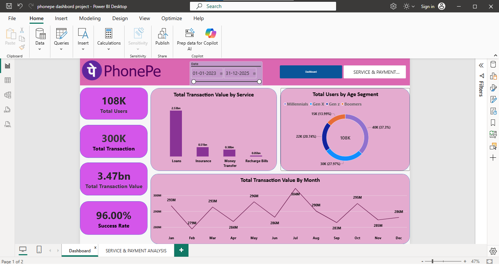

<div align="center">

# 📱 PhonePe Transaction Intelligence Dashboard

### Interactive FinTech Analytics | Microsoft Power BI

**Turning Digital Payment Data into Meaningful Business Insights**


</div>

---

## 📊 Dashboard Preview

### Page 1 — Transaction Overview



### Page 2 — Service & Payment Analysis


---

## 📌 Project Overview

The **PhonePe Transaction Intelligence Dashboard** is an interactive Power BI portfolio project designed to analyse digital payment activity, transaction value, service performance, payment outcomes, and user patterns.

Using an Excel dataset containing **300,000 transaction records and 107,658 user records**, this project transforms raw data into meaningful visual insights through KPI cards, interactive charts, and date-based analysis.

The dashboard helps explore service-level performance, payment-status distribution, unsuccessful transaction reasons, monthly trends, and customer segments.

> **Core Themes:** FinTech Analytics · Transaction Intelligence · Payment Performance · Business Intelligence · KPI Monitoring · Service-Level Analysis · Data Storytelling

## 🎯 Project Objectives

- Monitor transaction volume and total transaction value.
- Analyse payment statuses and unsuccessful transactions.
- Compare transaction value across services and service types.
- Identify frequently recorded reasons for unsuccessful payments.
- Explore monthly transaction-value trends.
- Analyse user distribution across age segments.
- Compare weekday and weekend transaction patterns.
- Support data-driven decision-making through interactive reporting.

## 🧰 Tools & Technologies

- **Microsoft Power BI Desktop** — interactive dashboard development.
- **Microsoft Excel** — dataset source.
- **Data Modelling** — transaction and user tables.
- **Data Visualisation** — KPI cards, donut charts, bar charts, column charts, and line charts.
- **Interactive Filtering** — date-range slicers and Top N filtering.
- **Business Intelligence** — KPI monitoring, trend analysis, and service comparisons.

## 📊 Dataset at a Glance

| Dataset Table | Records | Purpose |
|---|---:|---|
| `All_Transactions` | 300,000 | Transaction-level analysis |
| `All_Users` | 107,658 | User-level analysis |

**Transaction Date Coverage:** 01 January 2024 – 30 December 2024

### Key Dataset Fields

| Table | Fields |
|---|---|
| `All_Transactions` | `Transaction_ID`, `Amount`, `User_ID`, `Service`, `Service Type`, `Payment_Status`, `Reason`, `Date` |
| `All_Users` | `User_ID`, `Name`, `Age`, `Join_Date` |

## 🖥️ Dashboard Pages

### 1. Transaction Overview

This page provides a high-level overview of transaction activity, transaction value, and user distribution.

**Key KPIs displayed:**
- Total Users: **108K**
- Total Transactions: **300K**
- Total Transaction Value: **3.47bn**
- Success Rate: **96.00%**

**Visualisations:**
- Total Transaction Value by Service
- Total Users by Age Segment
- Total Transaction Value by Month
- Date-range slicer

**Business purpose:** Understand overall transaction performance, compare service contributions, and identify monthly changes in transaction value.

### 2. Service & Payment Analysis

This page focuses on payment outcomes, unsuccessful transaction reasons, and service-type performance.

**Key KPIs displayed:**
- Total Users: **108K**
- Total Services: **4**
- Failed Transactions: **12K**
- Success Rate: **96.00%**

**Visualisations:**
- Payment Status Distribution
- Failed Transactions by Reason
- Total Transaction Value by Service Type
- Total Transactions by Weekday and Weekend

**Business purpose:** Investigate payment outcomes, compare service types, and identify frequently recorded reasons for failed transactions.

## 📈 Analytical Highlights

The supplied dashboard screenshots show the following patterns:

- The report displays **108K users** and **300K transactions**.
- Total transaction value is displayed as **3.47bn**.
- The success-rate KPI displays **96.00%**.
- Loans have the highest displayed transaction value among the services shown.
- July is the highest month in the displayed monthly transaction-value chart, at approximately **304M**.
- The payment-status chart displays approximately **288K successful transactions (96%)**.
- The weekday/weekend chart displays approximately **215K weekday transactions** and **85K weekend transactions**.

*These observations are based on the supplied dashboard screenshots. Results can vary with filters, and the success-rate definition depends on the underlying calculation.*

## 🔍 Business Questions

1. What is the total transaction value for the selected period?
2. How many users and transactions are represented in the report?
3. What percentage of transactions is marked successful?
4. Which services contribute the highest transaction value?
5. Which reasons are most frequently recorded for unsuccessful transactions?
6. How does transaction value change month by month?
7. How are users distributed across age segments?
8. How do weekday and weekend transaction counts compare?
9. Which service types contribute the highest transaction value?

## 💡 Business Value

This project demonstrates how transaction data can be converted into an interactive reporting experience to support:

- **Performance Monitoring** — review KPIs at a glance.
- **Service Comparison** — compare transaction-value contributions.
- **Payment Analysis** — explore payment outcomes and recorded failure reasons.
- **Trend Analysis** — investigate month-wise changes.
- **Customer Segmentation** — explore user age groups.
- **Interactive Reporting** — filter and explore data visually.

## 🧠 Skills Demonstrated

`Power BI` `Business Intelligence` `FinTech Analytics` `Data Visualisation` `KPI Monitoring` `Transaction Analysis` `Payment Performance` `Service Mix Analysis` `Trend Analysis` `Failure-Reason Analysis` `Customer Segmentation` `Interactive Dashboards` `Data Storytelling` `Analytical Thinking`

## 🚀 How to Open the Project

1. Clone or download this repository.
2. Open the `.pbix` file using **Microsoft Power BI Desktop**.
3. If prompted, update the source path to the Excel dataset.
4. Verify the relationship between `All_Users[User_ID]` and `All_Transactions[User_ID]` if user-level filtering is required.
5. Open both report pages and explore the charts and slicers.

## 📂 Repository Structure

```text
PhonePe-Transaction-Intelligence/
│
├── README.md
├── phonepe-dashbord-project.pbix
├── Phonepe-Final-Dataset.xlsx
│
└── screenshots/
    ├── transaction-overview.png
    └── service-payment-analysis.png
```

**Important:** Keep the two screenshots in the `screenshots` folder using the exact filenames shown above. Otherwise, the dashboard images will not appear in the GitHub README preview.

## 💼 Resume-Ready Project Description

**PhonePe Transaction Intelligence Dashboard | Power BI**

Developed an interactive Power BI dashboard to analyse **300K transactions and 108K users**, covering transaction value, payment-status distribution, service-level performance, failed transaction reasons, monthly trends, age segments, and weekday/weekend patterns. Designed two complementary report pages with KPI cards and interactive visualisations to support data-driven analysis and business reporting.

## 🏷️ Project Keywords

`Power BI` · `FinTech Analytics` · `Business Intelligence` · `Transaction Intelligence` · `Payment Performance` · `KPI Monitoring` · `Data Visualisation` · `Trend Analysis` · `Failure Analysis` · `Customer Segmentation` · `Interactive Dashboards` · `Data Storytelling`

## ⚠️ Data Disclaimer

This is an independent learning and portfolio project based on the supplied dataset. It is **not an official PhonePe product or official PhonePe business report**. The displayed metrics should not be interpreted as PhonePe's actual live operational statistics.

---

<div align="center">

### Built with Curiosity. Designed for Insight. Powered by Data. 📊

**Thank you for visiting my project!**

</div>